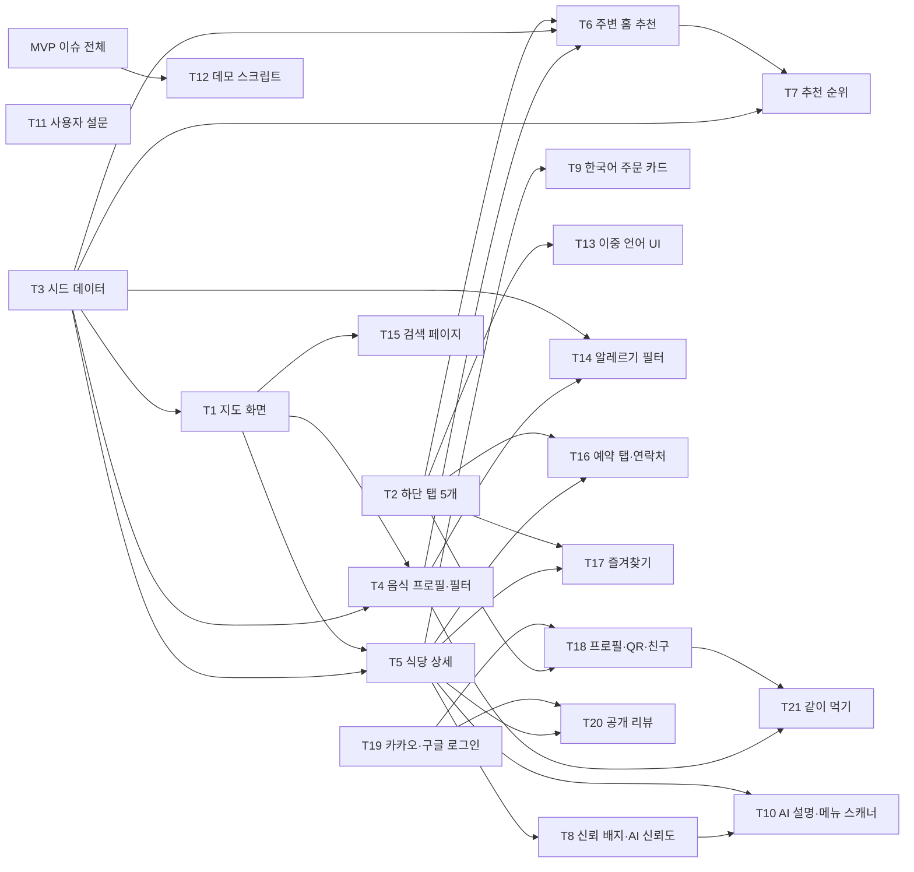

# 5주차 활동지 / Week 5 Worksheet

**1-page 기획서 / One-page plan**

- 작성일 / Date: 30일 9월
- 수정일 / Revised: 2026-10-28 (7주차 계획 변경 반영 / updated to match Week 7 plan)
- 참여자 / Present: 아디브, 아이만, 아킬, 아마르

---

## ① 주제 확정 / Confirm topic

- 확정 주제 / Topic: 먹지? (이전 이름: Halal Hunter (HxH))
- 이유 / Reason: 안산에 거주하는 무슬림 학생들은 어떤 음식과 장소가 할랄(halal)인지 확인하는 데 어려움을 겪고 있습니다. 공식 인증을 받은 할랄 관련 정보가 거의 없기 때문에, 학생들은 주로 다른 학생들의 입소문이나 개인적인 경험에 의존하는데, 이는 종종 신뢰하기 어렵습니다. 7주차에 범위를 할랄뿐 아니라 음식 프로필(할랄, 비건, 돼지고기 제외)과 알레르기 필터까지 넓혔습니다.

---

## ② 태스크 분해와 의존 관계 / Tasks and dependencies

앱 형태: **모바일 앱** (React Native + Expo, iOS·Android 하나의 코드베이스)

앱 구조: **하단 탭 5개** + 하위 화면
1. 홈 (Home) — 주변 추천 목록
2. 예약 (Reserve) — 식당 목록, 연락처 카드, 기록
3. 검색 지도 (Search map, 가운데·첫 화면) — 지도 + 검색 페이지
4. 즐겨찾기 (Favourites)
5. 프로필 (Profile) — QR, 친구, 설정, 음식 프로필
- 하위 화면: 식당 상세, 한국어 주문 카드, 메뉴 스캐너

태스크 번호는 7주차 GitHub 이슈 번호와 같습니다 (T1 = 이슈 #1). / Task numbers match the Week 7 GitHub issue numbers (T1 = issue #1).

| # | 태스크 Task | 완료 조건 Done when | 선행 태스크 Depends on | 담당 Owner |
|---|---|---|---|---|
| T1 | [Must] 지도 화면(첫 화면) | 앱이 2D 지도로 열리고 시드된 모든 식당에 핀이 표시됨; 각 핀에 음식 종류 로고와 배지 개수가 표시되며, 핀을 탭하면 식당 미리보기가 나타남 | T3 | Irfan |
| T2 | [Must] 하단 탭 5개 | 홈, 예약, 검색 지도(가운데), 즐겨찾기, 프로필 탭으로 화면이 전환되고, 앱은 검색 지도 화면으로 열림 | 없음 | Aqil |
| T3 | [Must] 식당 15곳 시드 데이터 | ERICA 주변 식당 최소 15곳, 각각 위치, 전화번호, 배지, 원산지, 메뉴 2개 이상, 초기 추천 수와 리뷰 점수 포함 (초기 값은 T20 공개 리뷰 완료 후 실제 데이터로 대체) | 없음 | Adib |
| T4 | [Must] 음식 프로필과 필터 | 할랄, 비건 또는 돼지고기 제외를 선택하면 조건에 맞는 핀은 강조 표시되고 나머지는 흐리게 표시되며, 홈 목록에는 조건에 맞는 곳만 표시됨 | T1, T3 | Nik Ammar |
| T5 | [Must] 식당 상세 페이지 | 식당을 탭하면 배지, 안전 / 먼저 확인 / 피하기로 표시된 메뉴와 빼야 할 재료, 원산지, 그리고 하단에 "예약하기" 버튼이 표시됨 | T1, T3 | Adib |
| T6 | [Must] 주변 홈 추천 | 홈에 프로필의 거리 설정 내 식당이 프로필 기준으로 필터링되어 표시되고, 음식 종류를 탭하면 목록이 필터링됨 | T2, T3, T4 | Irfan |
| T7 | [Must] 추천 순위 | 추천 수가 많고 리뷰가 좋은 식당이 그렇지 않은 식당보다 위에 표시됨 (MVP에서는 시드 데이터의 초기 값 사용) | T3, T6 | Irfan |
| T8 | [Must] 신뢰 배지와 AI 신뢰도 | 식당에 신뢰도와 그 출처가 표시되고, 메뉴에는 검증 횟수와 마지막 확인 날짜 또는 "미검증"이 표시됨 | T5 | Adib |
| T9 | [Must] 한국어 주문 카드 | 메뉴를 탭하면 한국어 문장과 영어 뜻이 전체 화면으로 표시되며, 최소 3개의 문구를 사용할 수 있음 | T5 | Aqil |
| T13 | [Must] 이중 언어 UI(한국어·영어) | 언어 설정을 변경하면 앱을 재시작하지 않고 모든 화면 텍스트가 한국어와 영어 사이에서 전환됨 | T2 | Aqil |
| T14 | [Must] 알레르기 필터 | "땅콩"을 선택하면 땅콩 태그가 붙은 모든 메뉴가 제외되고, 땅콩이 없는 메뉴가 하나도 없는 식당은 흐리게 표시됨 | T3, T4 | Adib |
| T15 | [Must] 검색 페이지 | 지도 검색창을 탭하면 사용자 선호에 맞는 인기 검색어와 최근 검색어 5개가 표시됨 | T1 | Irfan |
| T16 | [Must] 예약 탭과 연락처 카드 | 예약 탭에 식당 목록이 표시됨; "예약하기"를 누르면 전화번호와 전화·복사 버튼, 인원수 안내, 한국어 문장이 표시됨; 기록 탭에 연락한 곳이 표시됨 | T2, T5 | Aqil |
| T10 | [Should] AI 설명과 메뉴 스캐너 | 먼저 확인 메뉴에서 "왜?"를 누르면 이유와 출처가 표시됨; 테스트용 메뉴 사진을 넣으면 메뉴가 안전 / 먼저 확인 / 피하기로 분류되어 반환되고, 먼저 확인 메뉴마다 한국어 질문이 함께 제공됨 | T5, T8 | Nik Ammar |
| T11 | [Should] 사용자 설문 | 최소 8명(한국인 및 외국인)이 응답하고, 핵심 수치 1개와 인용 2개가 저장소에 저장됨 | 없음 | Irfan |
| T12 | [Should] 데모 스크립트와 발표 | 3분 분량의 스크립트가 있고, 팀이 데모를 처음부터 끝까지 한 번 실행해 봄 | MVP 이슈 전체 | Irfan |
| T17 | [Should] 개인 메모가 있는 즐겨찾기 | 식당에 별표를 누르면 개인 메모와 함께 즐겨찾기에 추가됨; 목록이 비어 있으면 빈 상태 화면이 표시됨 | T2, T5 | Aqil |
| T18 | [Should] 프로필, QR, 친구 | 프로필에 사진, 이름, QR 코드, 설정, 친구 수, 초대 링크가 표시됨; 친구의 QR을 스캔하면 친구로 추가됨 | T2, T19 | Adib |
| T19 | [Should] 카카오·구글 로그인 | 사용자가 카카오 또는 구글로 로그인할 수 있고, 앱을 재시작해도 로그인 상태가 유지됨 | 없음 | Nik Ammar |
| T20 | [Should] 사진 포함 공개 리뷰 | 로그인한 사용자가 별점, 텍스트, 사진, 식단 태그를 게시하면 다른 사용자가 식당 페이지에서 볼 수 있음 | T5, T19 | Adib |
| T21 | [Could] 같이 먹기(스트레치) | 서로 다른 프로필을 가진 친구 두 명을 선택하면 모두에게 맞는 식당만 남음 | T4, T18 | Irfan |

### 의존 관계 그래프 / Dependency graph (DAG)

---

## ③ 범위 결정 / Scope

### Must — 없으면 성립 안 됨 / essential

핵심 시나리오 1개가 끝까지 동작하는 데 필요한 것만 / *Only what the core scenario needs to work end-to-end*

핵심 시나리오 / Core scenario: 사용자가 앱을 열면 → 검색 지도에 ERICA 주변 식당 핀이 음식 종류 로고·배지 개수와 함께 보이고 → 음식 프로필(할랄 / 비건 / 돼지고기 제외)에 맞는 핀이 강조되며 → 핀을 눌러 상세 화면에서 메뉴를 안전 / 먼저 확인 / 피하기로 나누어 보고, 빼야 할 재료, 원산지, 신뢰도와 출처를 확인한다. 검증되지 않은 메뉴는 "미검증"으로 표시된다.
대상 태스크: MVP 마일스톤(11주차) — T1 ~ T9, T13 ~ T16

### Should (없을 경우에는 작성하지 마세요)

실행 패키지 마일스톤(13주차) — T10, T11, T12, T17 ~ T20

- AI 설명("왜?")과 메뉴 사진 스캐너 (T10)
- 사용자 설문 최소 8명 (T11)
- 3분 데모 스크립트와 발표 (T12)
- 개인 메모가 있는 즐겨찾기 (T17)
- 프로필, QR, 친구 (T18)
- 카카오·구글 로그인 (T19)
- 사진 포함 공개 리뷰 (T20)

### Could (없을 경우에는 작성하지 마세요)

- 같이 먹기: 서로 다른 프로필을 가진 친구 두 명에게 모두 맞는 식당만 표시 (T21, 시간이 허락하면)

### **Won't — 이번 학기에 안 함 / not this semester**

| Won't 항목 Item | 포기한 이유 Why |
|---|---|
| 공식 할랄 인증 검증 | 커뮤니티 기반 서비스이며 인증 기관 연동은 범위를 넘음. 신뢰 배지·검증 횟수(T8)로 대체 |
| 앱 안에서의 결제·주문·예약 처리 | 서비스 목적과 무관. 예약은 전화번호, 전화·복사 버튼, 한국어 문장 안내(T16)로 대체 |
| 길찾기 내비게이션 | 자체 구현 대신 외부 지도 앱 링크로 대체 |
| 관리자 페이지 | 데이터는 시드 데이터로 팀이 직접 관리 |
| App Store / Play Store 출시 | 수업에 필요 없음. 데모는 Expo Go로 실행 |
| ERICA·안산 외 지역 | 데이터 수집 범위 제한. 영향: 다른 지역 사용자는 사용할 수 없음 |
| 한국어·영어 외 언어 지원 | 한국어·영어 이중 언어 UI(T13)만 제공. 영향: 그 외 언어 사용자는 불편할 수 있어 이후 과제로 기록 |

### 실행 가능성 확인 / Feasibility check

- 특수 장비·유료 API·실제 개인정보가 필요한가? 필요하다면 대안은?
  - 특수 장비는 필요 없다. 테스트는 팀원 본인 휴대폰의 Expo Go로 하며, iPhone 테스트에 Mac이 필요 없다.
  - 지도는 `react-native-maps`를 사용하며 Expo Go 안에서 동작한다. 핀은 자체 데이터에서 가져온다.
  - 데이터는 Supabase(PostgreSQL)에 저장한다. 식당 이름, 전화번호, 좌표는 Kakao Local API로 수집한다. 무료 할당량 조건은 사용 전에 확인한다.
  - AI 호출(T10)은 Python FastAPI 서버를 거치므로 API 키가 앱에 포함되지 않는다. AI 서비스는 유료가 아니며, API 키는 Nik Ammar가 관리한다.
  - 위치는 기기에서만 사용하고 서버에 저장하거나 전송하지 않는다.
  - 카카오·구글 로그인(T19), 프로필 사진, 친구, 리뷰 사진(T20)으로 실제 개인정보를 다루게 된다.
  - 위험: 잘못된 할랄 정보를 주면 사용자에게 피해가 된다. 대안: 직원에게 직접 확인한 정보만 입력하고, 메뉴마다 검증 횟수와 마지막 확인 날짜 또는 "미검증"을 표시한다(T8).
- 15주차에 발표장에서 시연할 수 있는가? 가능하다. Expo Go로 휴대폰에서 실행한다.

## ④ 가장 먼저 동작시킬 흐름 (Walking Skeleton) / First end-to-end flow

예 / Example: 과제 ID를 입력하면 → LMS에서 제출 기록을 받아 와서 → 화면에 제출 인원 숫자 하나가 뜬다

> [무엇을 입력하면] → [무엇을 처리해서] → [화면에 무엇이 나온다]
>
앱을 열면 → Supabase에서 ERICA 주변 시드 식당 데이터를 가져와서 → 검색 지도 화면에 식당 핀이 표시되고, 핀을 탭하면 식당 미리보기가 뜬다

---

> 수업 종료 시 커밋하세요 / Commit this at the end of class
> `git add docs/week-05.md && git commit -m "docs: 5주차 활동지 7주차 계획 반영"`
